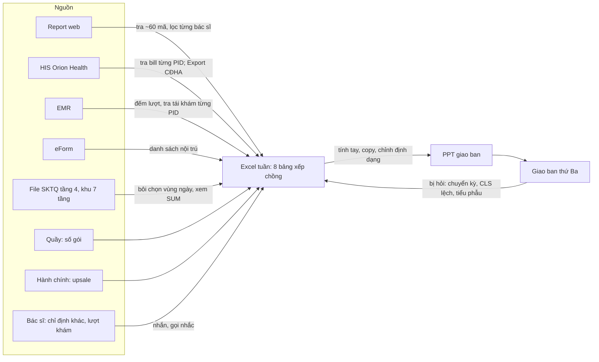
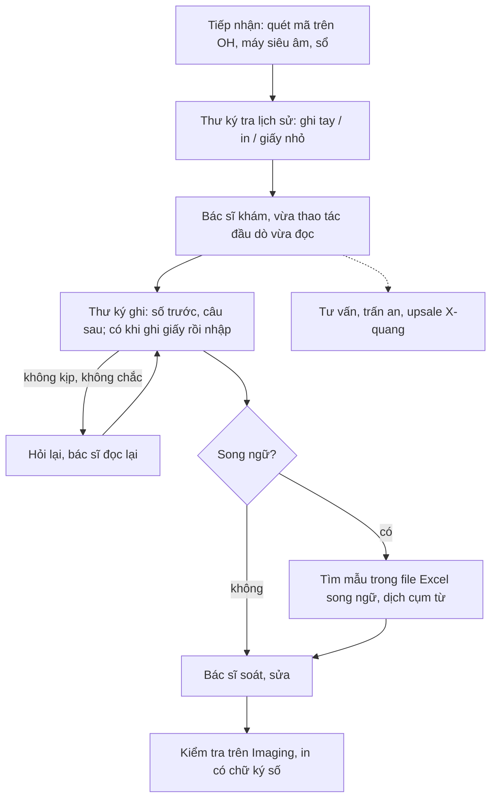
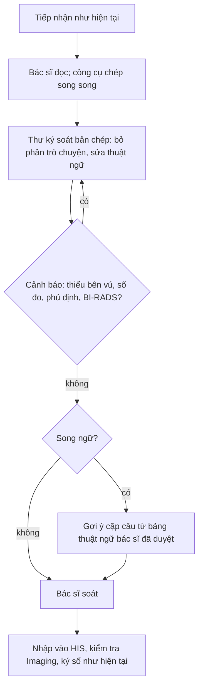

# Business Process — Quy trình hiện tại và đề xuất

> Status: v1 · 17/11/2026 · As-is vẽ lại từ BC 30/10, 31/10, 02/11, 03/11, 16/11 (doanh thu) và BC 04/11, 05/11, 09/11, 12/11 (siêu âm). To-be là đề xuất, chưa được khoa duyệt.

## 1. Báo cáo doanh thu tuần

### 1.1. Lịch tuần (as-is)

| Thời điểm | Việc | Ai |
|---|---|---|
| Hằng ngày | Theo dõi số khách, nhưng **không chốt số theo ngày** | Thư ký, các phòng |
| Chiều thứ Bảy | Tra lượt 1: XN máu, nội trú, dịch vụ lẻ, CV bác sĩ, SKTQ | Thư ký |
| Sáng thứ Hai | Tra lượt 2 (ca phát sinh chiều thứ Bảy, Chủ nhật); làm lại từ đầu | Thư ký |
| Chiều thứ Hai | Dựng PPT giao ban | Thư ký + một bác sĩ (luân phiên) |
| Sáng thứ Ba ~7:30 | Giao ban: ~10 phút phần số liệu, rồi hỏi đáp | Bác sĩ trình bày, cả khoa |

### 1.2. Luồng as-is



Điểm chờ: bảng dịch vụ chung chờ quầy gửi số gói; bảng SKTQ chờ bộ phận SKTQ; chỉ định khác chờ bác sĩ nhập; dịch vụ còn ca ngày cuối tuần chờ thứ Hai.

### 1.3. Luồng to-be (đề xuất)

```mermaid
flowchart LR
  E[File Export: Report, OH máy ultrasound, OH procedure, EMR, eForm, SKTQ, upsale] --> I[Nhập: mỗi lượt dịch vụ một dòng, giữ nguồn]
  I --> C[Kiểm tra: trùng, thiếu, định dạng VND, đơn vị]
  C --> K[Phân loại theo danh mục quy tắc đã duyệt]
  K -->|chưa đủ căn cứ| D[Hàng chờ đối soát]
  D -->|thư ký xác nhận, có lý do| K
  K --> T[Tính: 4 phần doanh thu, bóc tách gói, SKTQ, chuyển kỳ]
  T --> S[Chốt snapshot theo ngày / tuần]
  S --> V[Kiểm lỗi: Report | OH | Máy, ca ngoại lệ, biến động]
  V --> O[Xuất Excel theo mẫu + PPT 9 slide, ghi đơn vị và ghi chú biến động]
  O --> G[Giao ban]
```

Khác biệt chính so với as-is:

| As-is | To-be | Giải quyết |
|---|---|---|
| Tra hai lượt, lượt 2 làm lại | Chốt theo ngày; lượt 2 chỉ thêm dòng mới | N1, DN13 |
| Quy tắc trong kinh nghiệm | Danh mục quy tắc có phiên bản, Trưởng khoa duyệt | DN08, DN11 |
| Ba nguồn lệch, không ghi lý do | Bảng đối chiếu Report \| OH \| Máy \| Lý do | N2 |
| Copy Excel → PPT, chỉnh lại định dạng | PPT sinh từ snapshot theo mẫu cố định | N3, N4 |
| Sửa upsale phải sửa tay nhiều bảng | Sửa một chỗ, mọi bảng tính lại | N5 |
| Lý do biến động nói miệng | Ô ghi chú biến động, dòng ca chuyển kỳ | BC 03/11 |

### 1.4. Việc khoa làm được ngay trong Excel (không cần công cụ)

Từ BC 31/10, 02/11, 16/11. Nên gửi khoa như một tài liệu riêng, tách khỏi công cụ của nhóm:

1. Freeze Panes 2 dòng đầu và cột tên dịch vụ.
2. Định dạng một lần: tiền `#,##0`, tỷ lệ `0.0%`; không copy số từ PPT ngược về Excel.
3. Bảng nhật ký upsale mỗi dòng một ca; bảng doanh thu tính bằng SUMIFS/COUNTIFS.
4. PPT dán liên kết (Paste Link) từ vùng Excel đặt tên `Slide2`, `Slide3`…
5. Mỗi bên điền một sheet mẫu trên SharePoint, không dán ảnh; có ô "đã nộp".
6. Sổ tay thư ký 1–2 trang ghi các quy tắc trong [BUSINESS_RULES.md](BUSINESS_RULES.md).

### 1.5. RACI (to-be)

| Việc | Thư ký khoa | Bác sĩ giao ban | Trưởng khoa | Nhóm TC-14 | Bộ phận SKTQ / hành chính |
|---|---|---|---|---|---|
| Export file nguồn | R | | | | R (file SKTQ, upsale) |
| Nhập và kiểm tra | R | | | C | |
| Duyệt danh mục quy tắc, giá | C | C | **A** | R (soạn) | |
| Đối soát dòng chờ | R | C | A | | C |
| Chốt snapshot | R | | A | | |
| Dựng PPT | R | R | | | |
| Trình bày giao ban | | R | A | | |
| Bảo trì công cụ | | | I | R | |

## 2. Ghi kết quả siêu âm

### 2.1. Luồng as-is



Song song, thư ký còn tiếp nhận khách sau, điền Excel sổ siêu âm, tư vấn upsale, có lúc phụ trách hai phòng (BC 04/11, 05/11, 10/11).

### 2.2. Luồng to-be (đề xuất)



Công cụ **không** ghi vào HIS, không tự kết luận BI-RADS, không dịch máy tự do nội dung y khoa. Điểm kiểm soát Imaging + chữ ký số giữ nguyên (SP-08).

### 2.3. RACI (to-be)

| Việc | Bác sĩ siêu âm | Thư ký phòng SA | Trưởng khoa | Nhóm TC-14 |
|---|---|---|---|---|
| Đọc kết quả | R | | | |
| Soát bản chép | C | R | | |
| Duyệt bảng thuật ngữ Việt–Anh | R | C | A | R (soạn) |
| Ký kết quả | **A/R** | | | |
| Đồng ý ghi âm khi thử | R | R | A | R (xin) |
