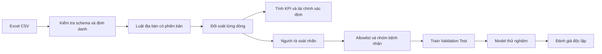

# Phân tích liên khoa và chuẩn bị model

Bản phát triển 31/10/2026, VU-ROUTING-1. Mục đích là đưa khung prompt vào một pipeline có kiểm tra dữ liệu, số liệu truy nguồn và bộ nhãn có phiên bản. Đây vẫn là ứng dụng local, chưa phải hệ thống production.

## Cách sử dụng

1. Mở http://127.0.0.1:4173/ và chọn **Liên khoa & dữ liệu model**.
2. Chọn ngày hoặc khoảng ngày. Dữ liệu báo cáo hiện tại được dùng mặc định, có thể chọn tối đa 10 Excel/CSV và bấm Kiểm tra & phân tích các file. Mỗi file tối đa 10 MB/10.000 dòng, cả đợt tối đa 20.000 dòng.
3. Kiểm tra tab Cột & bằng chứng: khoa nào xuất hiện, các mã phòng đã ánh xạ, file và cột đã đọc. Không tự suy ra khoa/phòng từ tên dịch vụ. Một file thiếu cột làm cả đợt dừng; không bỏ qua file rồi báo đủ dữ liệu.
4. Xem Tổng hợp & tài chính; mở Dòng nguồn để xem căn cứ từng chỉ định, cảnh báo và nguồn file/dòng. Chỉ hiển thị các dòng có ngày chỉ định hoặc hoàn thành trong kỳ; các chỉ báo lỗi toàn nguồn ghi rõ phạm vi.
5. Duyệt nhãn từng dòng đã qua kiểm tra, nhập mã người rà soát và căn cứ. Sửa nhãn không sửa dữ liệu báo cáo. Mã người rà soát là trường mô phỏng, chưa có xác thực nhân viên.
6. Vào Nhãn & dữ liệu model, xuất JSONL. Tải manifest bằng nút riêng sau khi xuất để tránh trình duyệt chặn nhiều file tải tự động. Mặc định chỉ xuất nhãn đã duyệt; có thể bật nhãn quy tắc trên dữ liệu giả lập để thử pipeline.

Import liên khoa giữ trong bộ nhớ của phiên hiện tại, mất khi reload hoặc rời màn hình. Nhãn được lưu trong localStorage `vinmec-routing-reviews-v1` có Web Locks và revision. Dữ liệu hàng đợi bệnh nhân và báo cáo gốc không bị thay bằng file phân tích thử. Kho nhãn hỏng bị khóa, không tự thay bằng kho trống.

## Những điểm đã điều chỉnh trong prompt

| Nội dung ban đầu | Hợp đồng triển khai |
|---|---|
| Mọi dòng luôn vào một trong 4 nhóm | Chỉ áp dụng khi đủ căn cứ. Khoa/phòng lạ hoặc mâu thuẫn trả null, chờ đối soát |
| Danh sách có CT-VU-01/02, XQ trung tâm | Tách profile prompt-kb khỏi local-12; không tự thay cơ cấu 12 phòng đã chốt |
| Doanh thu chỉ định/thực hiện | Hai góc nhìn giá trị nguồn độc lập; chưa có quy tắc hạch toán hoặc thực thu được duyệt |
| Biến trống thành 0/ước tính | Không điền tiền thiếu từ danh mục. Giá trị đã biết và số dòng thiếu trình bày riêng |
| BI-RADS 4/5 = phát hiện ác tính | Chỉ ghi nhóm nghi ngờ từ trường cấu trúc; không kết luận ác tính |
| visit_id khác là trùng bệnh nhân | Nhiều lượt có thể hợp lệ; trùng tên + SĐT giữa nhiều patient_id chỉ là ứng viên đối soát |
| Few-shot bảo đảm chính xác | Few-shot hướng dẫn hành vi, không chứng minh độ chính xác. Cần kiểm thử độc lập và rà soát người dùng |
| API key trong URL/frontend | Chưa gọi API. Tích hợp sau phải qua backend, secret và kiểm tra đầu ra |

Prompt đã hiệu chỉnh tại `model/system-prompt.md`. Code hiện chạy luật xác định, không gửi dữ liệu cho OpenAI/Gemini hay bên thứ ba. Không chọn hoặc gọi model API cũ trong ví dụ khi chưa cấu hình nhà cung cấp và chính sách dữ liệu.

## Công thức và phạm vi KPI

- A: VU → VU; B: VU → khoa khác; C: khoa khác → VU; D: cả hai khoa ngoài VU. Khoa ngoài phải là mã đã biết; chưa biết không đồng nghĩa ngoài phạm vi.
- Nhóm dịch vụ lấy từ danh mục mã 87 dịch vụ. Khoa thực hiện trong danh mục không ghi đè khoa thực hiện thực tế; không tự chuyển bệnh nhân theo nhóm phân tích này.
- Sản lượng hoàn thành chỉ lấy HOANTHANH, in_snapshot=1, ngày hoàn thành theo +07 trong kỳ. Hủy/hoàn tiền không cộng; hoàn tiền có sản lượng vẫn cảnh báo, không tự tạo số tiền bù trừ.
- Giá trị chỉ định lấy gross_order_vnd theo ngày chỉ định. Thiếu tiền nguồn được đếm thiếu; tiền không khớp quantity × unit_price được cảnh báo và không cộng trong phần đã biết.
- Giá trị thực hiện lấy completed_gross_vnd theo ngày hoàn thành. completed_net_vnd thiếu giữ thiếu; TRONGGOI phải có package_id và phân bổ khớp, không phân chia giá gói tùy ý.
- MUALE / THEMNGOAIGOI / TRONGGOI là ba bucket riêng. Giá trước giảm của dòng trong gói là giá trị tham chiếu nguồn, không phải khoản thu thêm. A xuất hiện ở cả hai góc nhìn nên tuyệt đối không cộng hai góc nhìn làm tổng doanh thu.
- Referral: tử số = số visit_id có chỉ định outbound CĐHA cao cấp hoặc nhóm Di truyền; mẫu số = số visit_id có dòng khám do VU chỉ định. Chỉ lấy cùng lượt, cùng kỳ chỉ định. Không có mẫu số thì tỷ lệ null. Không bao gồm mọi dòng GPB như một xét nghiệm gen.
- BI-RADS: đọc trường birads số nguyên 0..6. Không trích từ tên hoặc mô tả tự do. Báo độ phủ cấu trúc trên các dòng CĐHA liên quan Vú đã hoàn thành trong kỳ. Khi thiếu độ phủ, không tính tỷ lệ. Nhóm 4/5 đồng xuất hiện với chỉ định GPB/phẫu thuật cùng lượt/kỳ chỉ là mô tả, chưa xác nhận thứ tự hoặc quan hệ nhân quả.
- Đếm dòng dịch vụ, đơn vị completed_qty và lượt distinct visit_id được phân biệt. Số dòng can thiệp không được gọi là số ca mổ.

## Hợp đồng đầu vào

Sheet CANONICAL hoặc sheet đầu. Cột bắt buộc: order_id, patient_id, visit_id, service_code, ordering_dept, performing_dept, ordered_at, quantity, completed_qty, unit_price_vnd, status, price_mode, discount_known, in_snapshot.

Dòng hoàn thành cần completed_at và completed_gross_vnd để qua kiểm tra; completed_net_vnd có thể thiếu và bị cảnh báo. Các trường tài chính khác: gross_order_vnd, discount_vnd, package_id, package_allocation_vnd. performing_room tùy chọn; khi có thì phải thuộc profile đã chọn và khớp performing_dept. birads tùy chọn, cần nguồn chuyên môn xác nhận.

Có ánh xạ một số tên cột Việt được công bố trong `importSchema.mjs`; không dùng AI đoán cột. Nếu đồng thời có Mã DV và service_code, dừng vì mơ hồ. Mã định danh phải ở dạng chuỗi để giữ số 0 đầu. Ngày dùng ISO có offset hoặc ngày YYYY-MM-DD; Excel serial theo giờ Việt Nam. File tiền có dấu phân cách như 550.000 dạng text cần chuẩn hóa về số VND trước khi nhập, không tự đoán đơn vị.

Dữ liệu mới trong màn hình liên khoa giữ nguyên tiền nguồn, không tự tính thêm completed_gross/net thiếu như cơ chế hỗ trợ của màn hình nhập báo cáo cũ. Quy trình nhập khác nhau được tách riêng; không sửa luật báo cáo đã được audit.

## Bộ nhãn và quyền riêng tư

Một nhãn cần fingerprint dòng nghiệp vụ, profile, rulesVersion, label, mã người duyệt, lý do và thời điểm. Nhãn hết hiệu lực khi nguồn/profile/rules đổi. Dòng bị chặn hoặc có nghi ngờ danh tính không xuất train. Mặc định không dùng nhãn máy; synthetic_rule_silver phải bật riêng và chỉ dùng dòng có cờ mô phỏng.

Export chạy trên toàn bộ nguồn hiện tại, không giới hạn kỳ KPI. Chỉ xuất: schema_version, example_id, patient_group, split, features, label, label_source, synthetic, rules_version. Features gồm ordering_dept, performing_dept, performing_room, service_code, service_group, profile. Không có tên, SĐT, raw patient/visit/order ID, tiền, ngày hoặc văn bản tự do. HMAC khóa ngẫu nhiên mỗi export tạo mã giả danh và khóa bị bỏ sau export; cùng raw patient_id luôn ở một split trong bộ đó. Nếu cùng người có nhiều patient_id chưa phát hiện thì vẫn có nguy cơ leakage; cần đối soát master patient index trước dùng thật.

Giả danh không đồng nghĩa vô danh; tổ hợp dịch vụ vẫn có thể nhạy cảm. JSON phân tích khác JSONL training: JSON phân tích có mã nguồn để truy vết, không được coi là bộ khử định danh. Không tự gửi các file này ra ngoài.

Mỗi lần xuất tạo mã và split khác; cần giữ nguyên dataset + manifest đã xuất để tái lập thí nghiệm. Không nối tùy ý nhiều bản export hoặc ghi đè tập test. Một người duyệt local chưa phải gold standard; cần hai người duyệt độc lập, xử lý bất đồng và tách bộ test trước khi dùng model thật.

## Chạy model baseline local

Node 22+ dùng cho ứng dụng; Python 3.10+ dùng cho script model, không cần cài thư viện Python ngoài.

```sh
# Thử pipeline bằng dữ liệu mô phỏng, chọn thư mục mới chưa có
node scripts/export-training-demo.mjs model-run-001
python model/train_baseline.py model-run-001/dataset.jsonl --output model-run-001/result --allow-synthetic-silver

# Huấn luyện trên bộ nhãn người duyệt đã xuất từ UI
python model/train_baseline.py path/to/vu-routing-dataset.jsonl --output model-run-reviewed-001

# Kiểm thử
npm test
python -m unittest discover -s tests -p test_model_baseline.py
npm run audit
npm run build
```

Baseline là categorical Naive Bayes bằng thư viện chuẩn Python, chọn alpha trên validation rồi đánh giá test sau. Nó chỉ học phân loại địa bàn, không phải LLM, không dự đoán chẩn đoán, không tính tiền và không được gắn vào chuyển phòng. Script chặn trùng example_id, cùng patient_group ở nhiều split, thiếu split, nhãn ngoài hợp đồng, feature chứa target/ID lạ và nhãn silver không được bật rõ. Không ghi đè kết quả cũ.

Mô phỏng đã chạy nằm trong docs/model-demo: 2.594 mẫu, 630 nhóm bệnh nhân; train 2.062, validation 233, test 299. Model chưa có lỗi trong test mô phỏng; các nhãn chỉ do luật sinh, và chính khoa chỉ định/thực hiện đã quyết định nhãn, nên đây là kiểm tra khả năng chạy pipeline trên bài toán đơn giản, không phải bằng chứng khả năng tổng quát hóa dữ liệu thật. Với 0 lỗi/299 mẫu, cận trên 95% xấp xỉ theo rule-of-three vẫn khoảng 1,00%, chưa chứng minh <0,05%. Bộ chuẩn số học 182 phép đối chiếu có sai số 0% là phép đo khác với sai số model.

## Kiến trúc và phần cần phát triển tiếp



Cần backend có database giao dịch, quyền theo nhiệm vụ và phạm vi dữ liệu, version danh mục/địa bàn có ngày hiệu lực, kho nguồn bất biến, quy trình sửa nhãn không mất lịch sử, bộ chuẩn từ khoa và hạ tầng quản lý model. Nhãn hiện có thể cập nhật thay thế, chưa có lịch sử hai người duyệt hoặc chữ ký. Chưa có khả năng rollback model/deploy tự động. Việc này không được che bằng một system prompt.

Đã kiểm tra 64 test JavaScript và 5 test Python. Audit tài chính cũ 182 phép đối chiếu vẫn khớp 0% trên dữ liệu giả lập. Chưa có bộ tham chiếu thật cho các KPI liên khoa mới hoặc dữ liệu BI-RADS đầy đủ; chưa cam kết ngưỡng <0,05% trong vận hành.
