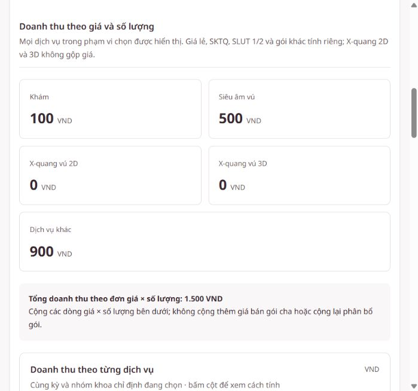

# Doanh thu các khoa và tất cả dịch vụ

Ngày cập nhật: 18/11/2026.

## Cách xem

Mở Báo cáo giao ban, chọn kỳ báo cáo. Khối **Doanh thu toàn bộ khoa** hiển thị các dòng hoàn thành, đủ điều kiện đưa vào báo cáo trong kỳ, thuộc mọi khoa có trong dữ liệu nguồn. Không giới hạn ở SLUT hoặc bốn nhóm khám/siêu âm/X-quang. Các dịch vụ khác như sinh thiết, xét nghiệm, can thiệp cũng được tính khi có danh mục và giá hợp lệ.

Có thể lọc Tất cả khoa, một khoa chỉ định hoặc một khoa thực hiện. Bốn góc nhìn gồm khoa chỉ định, khoa thực hiện, luồng liên khoa và nhóm giá (lẻ, SKTQ, SLUT 1, SLUT 2, gói khác, chưa xác định). Biểu đồ và bảng dịch vụ cập nhật theo cùng bộ lọc.

## Nguyên tắc tính

- Cùng một dòng chỉ cộng một lần trong tổng. Các bảng khoa chỉ định và khoa thực hiện phân tích cùng nguồn, không cộng hai bảng với nhau.
- Giữ bốn luồng riêng: Vú tại Vú, Vú chỉ định ra ngoài, khoa khác chuyển về Vú, và dịch vụ hoàn toàn của khoa khác.
- Giá nhân số lượng, làm tròn nửa lên theo từng dòng nguồn rồi cộng, dùng bộ tính PRICE-QTY-2. Giá lẻ và giá phân bổ từng gói giữ riêng; không cộng lại giá bán gói cha.
- Thiếu giá hoặc chưa xác nhận khoa phòng phải đối soát; không tự gán giá bằng 0 hay tự suy khoa từ tên dịch vụ. Tổng đủ giá chưa phải tiền thực thu.
- Không gộp hoặc xóa dịch vụ chỉ vì trùng PID. Quy tắc định danh và cảnh báo đã có tiếp tục áp dụng.
- Phần chỉ tiêu giao ban riêng Khoa Vú vẫn giữ phạm vi Khoa Vú chỉ định. Khối toàn bộ khoa có nhãn phạm vi riêng để người xem phân biệt.

## Bản chốt và xuất báo cáo

Bản chốt mới giữ cả dữ liệu mọi khoa và cấu hình giá tại thời điểm chốt. Backend tính lại từ nguồn, không tin tổng tiền do trình duyệt gửi. Thay bộ lọc trên màn hình không làm thay đổi nguồn của bản chốt. Bản báo cáo cũ không bị viết lại; nếu chưa có dữ liệu chốt toàn khoa, màn hình ghi rõ đang xem dữ liệu hiện tại.

Excel của bản chốt mới bổ sung DT_KHOA_CHI_DINH, DT_KHOA_THUC_HIEN, DT_NHOM_GIA, DT_TAT_CA_DICH_VU. Mẫu DATA_KHOAVU hiện có được giữ. PowerPoint bổ sung các trang phân tích tương ứng. Các phần xuất cùng dùng dữ liệu chốt toàn khoa.

## Kiểm chứng

272 kiểm thử Node, 71 kiểm thử Python và build đạt. Có kiểm thử khớp tổng giữa các cách phân nhóm, dịch vụ ngoài khoa Vú, giá gói khác, thiếu giá, khoa chưa xác nhận, PID lặp, bản chốt và xuất Excel/PowerPoint. Có kiểm thử backend từ chối tổng tiền giả và sửa dữ liệu chốt.

Kiểm tra trình duyệt trên SQLite trong bộ nhớ: 5 dòng thử, tổng 1.500 VND; riêng Vú chỉ định 800 VND. Lọc Nội khoa cho 400 VND; tải lại bản chốt vẫn giữ tổng toàn khoa 1.500 VND. Console không có lỗi. Đây là dữ liệu kiểm thử kỹ thuật, không phải doanh thu vận hành hoặc chứng nhận sai số thực tế dưới 0,05%.

